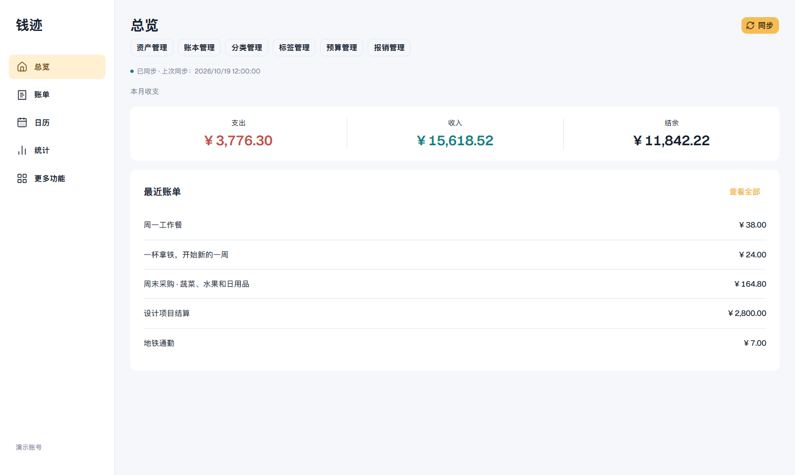
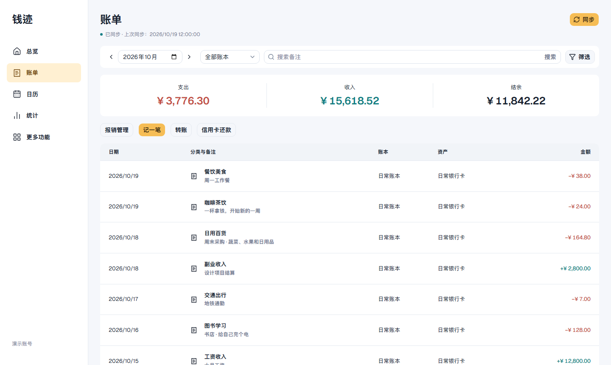
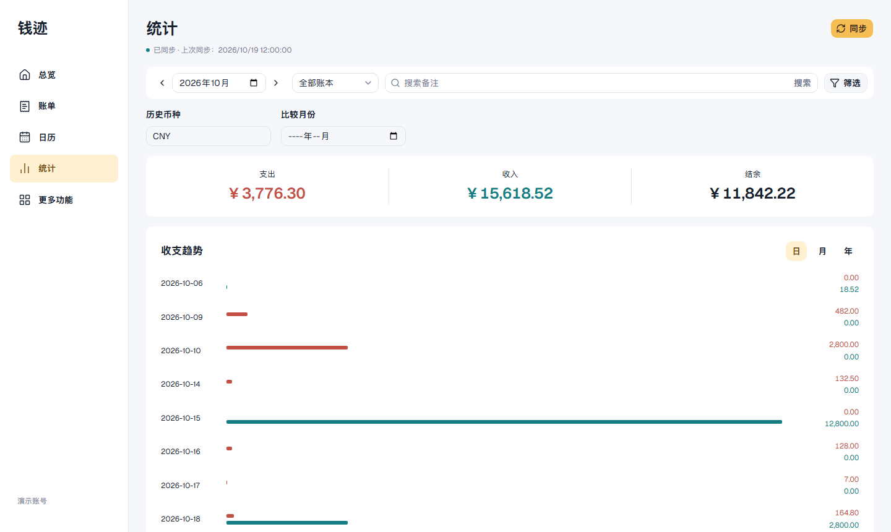
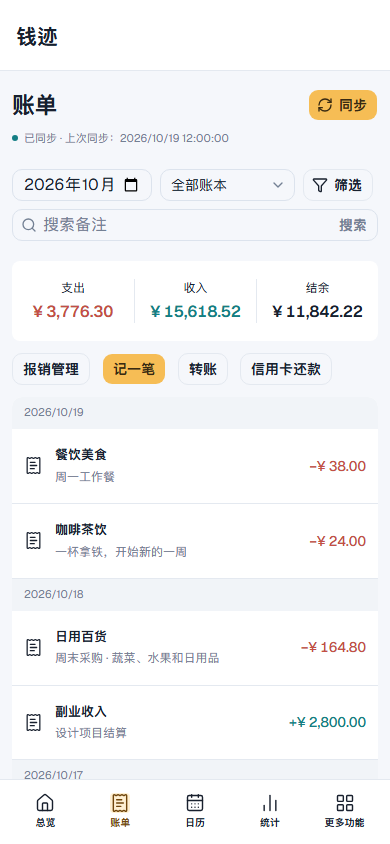

<h1 align="center">钱迹 Web · MCP</h1>

<p align="center">
  浏览器里的钱迹工作台，也为 ChatGPT 提供记账工具。
</p>

<p align="center">
  
  
  
  
</p>

<p align="center">
  <a href="#界面预览">界面预览</a> ·
  <a href="#快速开始">快速开始</a> ·
  <a href="docs/deployment.md">部署与 ChatGPT 接入</a> ·
  <a href="docs/acceptance/protocol-gaps.md">功能边界</a>
</p>



<p align="center"><sub>真实界面截图，全部使用虚构演示数据，不含个人账本或账号信息。</sub></p>

## 一套数据，两种使用方式

在网页中查看收支、管理资产和记录日常开销；通过 Streamable HTTP MCP，将相同的业务能力交给 ChatGPT 等 MCP 客户端。页面使用 React 19、Tailwind CSS 4 与 shadcn/Radix，适配桌面和手机。

| 能力 | 支持内容 |
| --- | --- |
| **日常记账** | 普通与外币账单、优惠与手续费、转账、信用卡还款、退款和报销 |
| **查询分析** | 账单筛选、日历、收支趋势、多维统计及历史币种金额 |
| **资产与资料** | 资产、借贷、账本、分类、标签、预算与图片 |
| **计划管理** | 周期任务、分期、存钱计划；未来账单由钱迹处理 |
| **持续操作** | 本地草稿、同步进度、原操作跟踪与未知结果只读核查 |

## 界面预览

<table>
  <tr>
    <td width="50%"><strong>账单管理</strong><br /><sub>按月查看、筛选搜索，直接记账与转账。</sub></td>
    <td width="50%"><strong>收支统计</strong><br /><sub>查看收支趋势，按历史币种计算金额。</sub></td>
  </tr>
  <tr>
    <td><a href="docs/images/bills.png"></a></td>
    <td><a href="docs/images/statistics.png"></a></td>
  </tr>
</table>

<details>
  <summary><strong>查看手机端效果</strong> · 紧凑的账单卡片与底部导航</summary>
  <br />
  <p align="center">
    
  </p>
</details>

## 为单用户部署设计

- **存储简单**：Worker Static Assets + 一个 SQLite Durable Object，使用 Cloudflare 自带存储，无需另配 D1、R2、队列或 Cron。
- **按需更新**：超过60秒来源校验窗口才按需增量同步；显式同步保留原游标和5秒冷却，闲置不轮询。
- **保留操作依据**：未知写入沿用原请求键，只读核查；版本冲突保留草稿，历史回执不覆盖较新数据。
- **连接直接**：手机号或邮箱加密码登录，可切换钱迹线路、检查登录状态及手动同步。

## 快速开始

需要 **Node.js 24** 和 **pnpm 11**。

```sh
git clone https://github.com/YOUR_USERNAME/qianji-web.git
cd qianji-web
pnpm install --frozen-lockfile
cp .dev.vars.example .dev.vars
```

在 `.dev.vars` 中配置32字节随机值的 Base64 `QIANJI_CREDENTIAL_KEY`，然后启动：

```sh
pnpm dev
```

打开本机页面，在 `/connection` 登录钱迹。密码、token 和实际 Secret 不应提交到仓库。部署、密钥配置及 ChatGPT 连接步骤见[部署文档](docs/deployment.md)。

<details>
  <summary>运行本地验证</summary>

```sh
pnpm verify
pnpm test:e2e
```

`verify` 包含类型检查、后端测试、生产构建与 Wrangler dry-run，不会实际部署。

</details>

## 当前范围

业务逻辑参考钱迹 **APK 4.5.4 / 1234**。提供范围内的原生业务已使用专用测试资源补验，正式 Web/MCP 写入已统一启用；测试资源已清理。接口已确认不支持或仍不明确的输入分支会在发送前拒绝，详见[验收矩阵](docs/acceptance/live-matrix.md)和[协议边界](docs/acceptance/protocol-gaps.md)。

本项目面向单用户，不提供应用登录保护、多用户、第三方登录、数据导出、本位币修改、全局排序或账本成员管理；访问保护交由 Cloudflare 配置。目前代码、审查与部署文档已交付，尚未实际部署或完成 ChatGPT 实接。

## 文档导航

| 开始使用 | 验证与维护 |
| --- | --- |
| [部署与 ChatGPT 接入](docs/deployment.md) | [版本状态与验收](docs/release.md) |
| [设计方案](docs/superpowers/specs/2026-10-18-qianji-workers-design.md) | [独立审查及修复](docs/acceptance/final-review.md) |
| [开发计划](docs/superpowers/plans/2026-10-18-qianji-development-plan.md) | [升级、暂停与数据库恢复](docs/maintenance.md) |
| [缓存与同步策略](docs/cache-policy.md) | [APK 核对与维护证据](docs/research/2026-10-19-apk-final-implementation-check.md) |
| [真实业务验收矩阵](docs/acceptance/live-matrix.md) | [专用测试数据清理记录](docs/acceptance/cleanup.md) |
